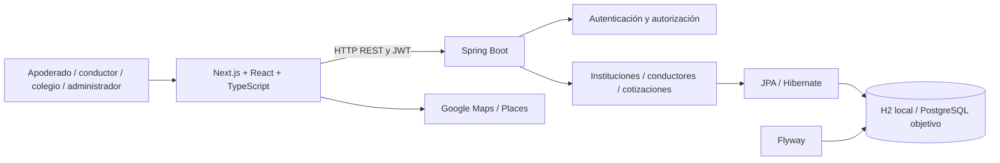
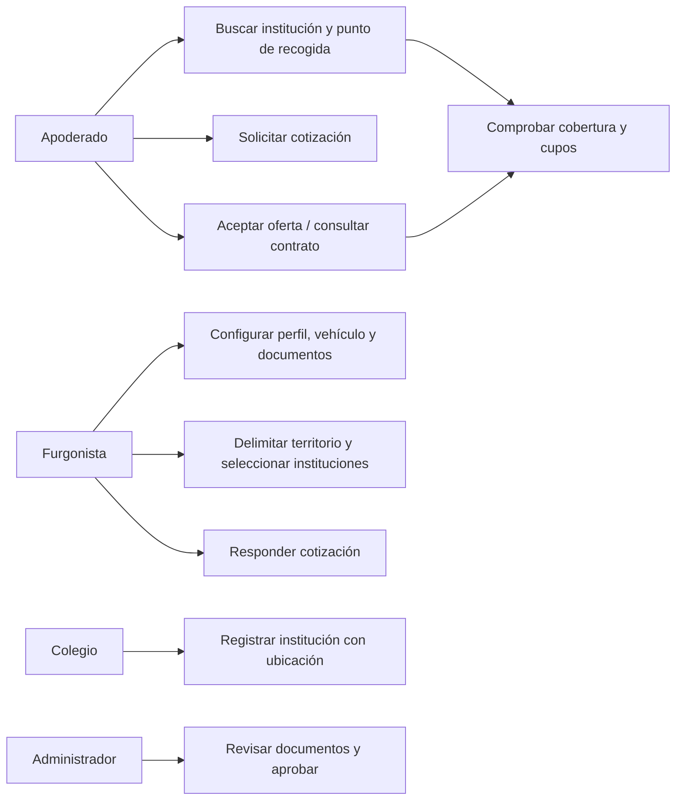
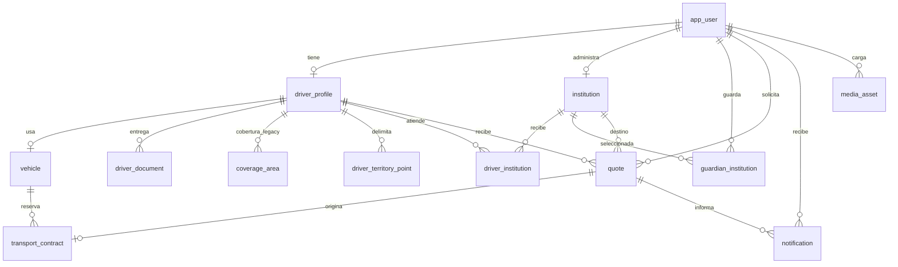
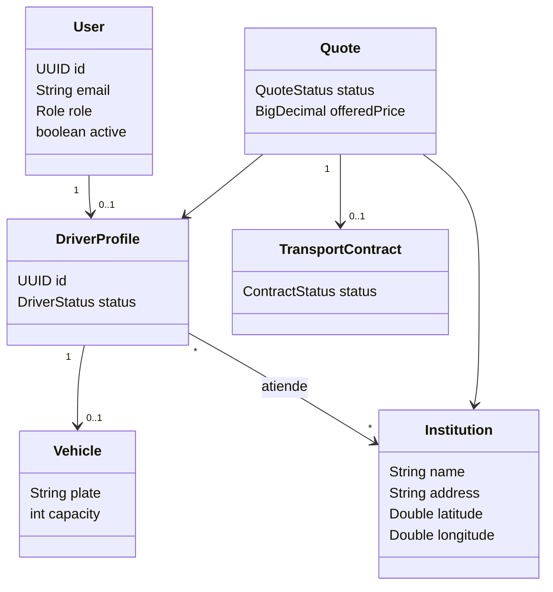
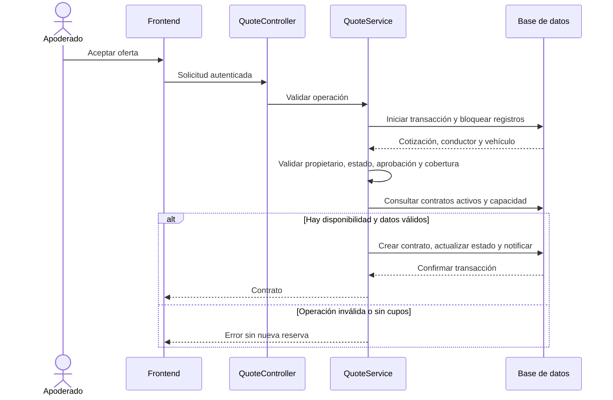

# Arquitectura, datos y diagramas del prototipo

Modelo derivado del código local al 21 de octubre de 2026. Los diagramas omiten atributos auxiliares para ser legibles; las migraciones Flyway y las clases son la fuente completa. V3 y V4 pertenecen a la ampliación local pendiente de publicar junto con su código.

## Componentes y despliegue lógico

La API concentra reglas de negocio y persistencia. El mapa ayuda a seleccionar ubicaciones; la API vuelve a validar territorio y disponibilidad, porque los controles del navegador no son una frontera de seguridad. El navegador recibe una clave de Maps destinada al navegador; sus restricciones de origen y APIs se configuran en Google Cloud.

## Casos de uso

Precondición de búsqueda: institución existente y punto de recogida definido para conductores con territorio. Precondición de oferta/aceptación: identidad y propiedad válidas. Si falta aprobación, se agotaron cupos o cambió la cobertura, la operación debe rechazarse sin crear un contrato parcial.

## Modelo entidad-relación resumido

Reglas físicas: email y patente únicos; un perfil conductor por usuario; un vehículo por perfil; un contrato por cotización; pares conductor/institución y apoderado/institución únicos. Los puntos territoriales se ordenan por `(driver_id, point_order)` y guardan latitud/longitud. La capacidad se limita a 1–60. La aceptación compara contratos activos y capacidad bajo transacción; una restricción estática por sí sola no representa la disponibilidad dinámica.

## Clases de dominio resumidas

Los nombres de atributos del diagrama son conceptuales abreviados. No pretende ser una copia exhaustiva de anotaciones JPA ni de todos los campos SQL.

## Secuencia de aceptación

## Decisiones y consecuencias

Se eligió monolito modular para mantener transacciones y permisos en un solo servicio durante el prototipo. JPA y Flyway separan el acceso a datos de la evolución del esquema. H2 reduce requisitos de la demostración, pero no reemplaza la prueba del motor PostgreSQL. Los polígonos representan recogida con mayor precisión que una comuna; requieren validar geometría y coordinar cambios de API, persistencia y navegador. Las pruebas simuladas de Maps no comprueban autorización real de la API ni todos los estados de carga del mapa.
