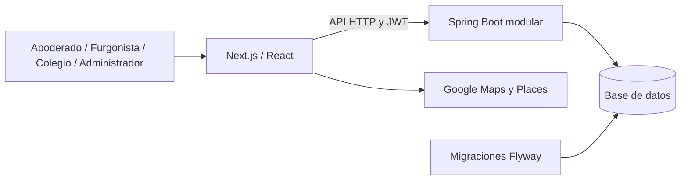

# FurgonApp - Síntesis técnica para completar las plantillas

**Estado:** base de redacción, no informe final evaluado. Preparada el 21 de octubre de 2026. Equipo confirmado: Juan Pablo Fuentes Valenzuela, principalmente desarrollo informático; Sebastian Mendez, documentación y preparación del despliegue. Proceso descrito como iterativo e incremental; calendario académico y sede por confirmar.

## 1. Problema y propuesta

La búsqueda y coordinación de transporte escolar requiere relacionar a familias, conductores e instituciones, conocer la cobertura de recogida y evitar solicitudes o reservas incompatibles con el servicio disponible. FurgonApp reúne esos flujos en una aplicación web con acceso por rol.

Esta formulación describe el problema abordado por el software; no acredita entrevistas, encuestas ni un estudio de mercado. Esas fuentes deberán incorporarse solo si el equipo las realizó y conserva su evidencia.

La propuesta permite que un colegio registre su institución, un conductor configure su perfil, vehículo y cobertura, un administrador revise sus documentos y un apoderado solicite transporte para una institución guardada. El proceso continúa con una oferta y una aceptación que reserva un cupo disponible.

## 2. Usuarios y responsabilidades

| Rol | Funciones implementadas |
|---|---|
| Apoderado | Registro, inicio de sesión, instituciones guardadas, selección de recogida, búsqueda, solicitud de cotización, aceptación y consulta de contratos |
| Furgonista | Perfil, vehículo, documentos, cobertura, colegios atendidos, gestión de cotizaciones y contratos |
| Colegio | Registro y edición de su institución, identidad visual y consulta de conductores asociados |
| Administrador | Revisión de documentos y perfiles, aprobación y gestión de cuentas |

El modelo no ofrece un acceso independiente para estudiantes. La revisión documental es administrativa y manual; el sistema no consulta registros gubernamentales ni garantiza por sí mismo la validez legal de un conductor.

## 3. Objetivo general propuesto para validar con el equipo

Desarrollar una plataforma web que permita vincular apoderados con conductores de transporte escolar según institución, cobertura y disponibilidad, incorporando gestión de perfiles, revisión documental y un flujo de cotización y reserva de cupos.

### Objetivos específicos propuestos

1. Gestionar registro, autenticación y autorización de apoderados, conductores, colegios y administradores.
2. Mantener información de instituciones, conductores y vehículos para la búsqueda de servicios.
3. Facilitar la selección geográfica de institución y punto de recogida mediante Google Maps y Google Places.
4. Incorporar delimitación territorial del servicio y comprobar la pertenencia del punto de recogida a la zona del conductor.
5. Gestionar solicitudes, ofertas y contratos sin sobrepasar la capacidad disponible del vehículo.
6. Verificar los flujos mediante pruebas automatizadas y documentar instalación, límites y pendientes.

La lista refleja el alcance observado; debe cotejarse con los objetivos aprobados inicialmente antes de incorporarla a una entrega de fase 1.

## 4. Alcance implementado y límites

### Funciones de la versión registrada en Git

El historial contiene una implementación inicial, una ampliación de registro e inicio de sesión persistentes y una incorporación de cuentas ficticias de presentación. Se mantienen documentación de API, arquitectura, validación y ejecución local.

### Ampliaciones presentes en la copia de trabajo

- Dirección georreferenciada obligatoria al guardar una institución, con coordenadas y Place ID.
- Mapa compartido de instituciones con búsqueda, sugerencias y tolerancia a ciertos errores de escritura.
- Delimitación de un territorio mediante un polígono editable de Google Maps.
- Comprobación del punto de recogida dentro del territorio al buscar, cotizar y aceptar.
- Compatibilidad temporal de perfiles anteriores con cobertura por comuna hasta guardar su primer territorio.
- Tutorial audiovisual narrado en español para dibujar y guardar la zona, con cursor animado.

Estos cambios permanecen sin commit en la copia inspeccionada. No deben presentarse como disponibles en la rama pública hasta que se publiquen y verifiquen. La documentación técnica anterior aún contiene descripciones de la cobertura exclusiva por comuna; debe actualizarse de forma coherente con esa publicación.

### Fuera del alcance acreditado

No hay cobros integrados, suscripciones operativas, seguimiento GPS, validación gubernamental automática, verificación de correo, recuperación de contraseña, MFA ni despliegue productivo verificado. El precio sugerido es una referencia simulada. Las notificaciones son internas, sin correo, WhatsApp o push.

## 5. Arquitectura y tecnologías

Frontend: Next.js 16, React 19 y TypeScript. Backend: Spring Boot 3.5 y Java 17 o superior. El backend es un monolito modular; no se implementan microservicios independientes. La interfaz usa un adaptador HTTP y reenvía `/api/*` hacia Spring.

Persistencia: entidades JPA, repositorios y migraciones Flyway. PostgreSQL está configurado como motor de despliegue. En este equipo se usa H2 persistente en modo PostgreSQL para la ejecución local. Los tests usan bases aisladas en memoria.

Google Maps y Places proporcionan la selección de direcciones y representación de puntos y polígonos. La clave del navegador se conserva en configuración local ignorada por Git; sus restricciones se configuran en Google Cloud. No se publica su valor en esta documentación.

Este esquema es una síntesis de componentes, no reemplaza los diagramas UML y ER solicitados por el instructivo.

## 6. Datos y consistencia

El sistema relaciona usuarios con perfiles de conductor, vehículos, instituciones, documentos, cobertura, cotizaciones, contratos y notificaciones. Las relaciones entre agregados se expresan mediante UUID y restricciones de base de datos.

La disponibilidad se obtiene restando los contratos activos de la capacidad del vehículo, en lugar de mantener un contador duplicado. La aceptación utiliza bloqueos pesimistas sobre cotización, perfil y vehículo, revalida las condiciones y confirma el contrato dentro de una transacción. Se restringe la duplicación de contrato para una misma cotización.

Las ampliaciones locales añaden ubicación de instituciones, una colección ordenada de vértices del territorio y coordenadas de recogida de la cotización. El polígono admite entre 3 y 100 puntos; se rechazan áreas degeneradas y bordes cruzados. El límite del polígono cuenta como cubierto.

## 7. Requisitos y verificación inicial

La especificación canónica de RF01 a RF12 y sus criterios de aceptación está en [REQUISITOS.md](REQUISITOS.md). Los modelos derivados están en [DISENO.md](DISENO.md).

| Aspecto no funcional | Situación observada / validación pendiente |
|---|---|
| Seguridad | BCrypt, JWT, restricciones de rol/propietario y cuenta activa; no equivalen a una auditoría de seguridad completa |
| Consistencia | Transacciones y bloqueos en aceptación; validar además con PostgreSQL objetivo |
| Usabilidad | Etiquetas y mensajes, estados de error, adaptación móvil y tutorial; falta evaluación formal con usuarios |
| Rendimiento | Faltan mediciones de latencia, carga, volumen y concurrencia representativa |
| Disponibilidad | Arranque local manual; no se acredita alta disponibilidad, monitoreo o recuperación productiva |
| Portabilidad | Dockerfiles y Compose presentes; ejecución Docker/PostgreSQL no acreditada localmente |
| Mantenibilidad | Módulos de dominio, tipado y tests; documentar decisiones y revisión de código |

## 8. Planificación y contribuciones

El historial inspeccionado contiene commits fechados el 23 y 28 de septiembre y el 7 de octubre de 2026. Las iteraciones locales posteriores incorporan mapas de instituciones, búsqueda tolerante, territorio y tutorial. Ese historial no permite atribuir automáticamente tareas a integrantes ni acreditar sprints o retrospectivas.

Roles informados por Juan Pablo: desarrollo informático principalmente a su cargo; documentación y preparación del despliegue a cargo de Sebastian. Se describe un proceso iterativo e incremental. Los objetivos y el cronograma de referencia deben cotejarse con calendario y acuerdos académicos reales; no son evidencia retrospectiva.

## 9. Pruebas y evidencias

El repositorio contiene pruebas de cuentas, flujo de negocio y presentación. La copia de trabajo añade pruebas de ubicación de instituciones, geometría territorial, persistencia y autorización, interacción de mapa y reproducción del tutorial. Hay reportes locales de ejecuciones anteriores; sus fechas y resultados deben conservarse y adjuntarse al informe sin atribuirles una ejecución nueva.

Para la entrega definitiva se debe generar un informe reproducible con comando, fecha, entorno, resultado y limitación. Distinguir siempre las pruebas con dobles de Google Maps de las comprobaciones reales del proveedor. Un fallo real del mapa vacío se detectó en el navegador y se corrigió inicializando explícitamente su colección de puntos; la prueba simulada fue ajustada para reproducir ese caso.

No se acreditan pruebas de carga, pentesting, usabilidad con usuarios finales ni validación PostgreSQL simplemente porque las pruebas automatizadas locales hayan pasado.

## 10. Innovación y valor

La combinación de selección institucional, zona de recogida delimitada y disponibilidad aporta una forma de evitar coincidencias demasiado amplias basadas exclusivamente en el nombre de una comuna. Las sugerencias del buscador y el tutorial ayudan a utilizar ese flujo.

El valor propuesto es facilitar la coordinación y reducir solicitudes incompatibles con el territorio o los cupos del conductor. No se afirma una reducción cuantificada de tiempos ni superioridad frente a otras plataformas sin un estudio y mediciones reales.

## 11. Cierre del portafolio

Se prepararon informes Word, documentos individuales, presentaciones y modelos técnicos. El [control de entregables](../../../CONTROL-ENTREGABLES.md) distingue lo completado de las plantillas pendientes, revisión personal, planillas del docente y validaciones técnicas no acreditadas.
